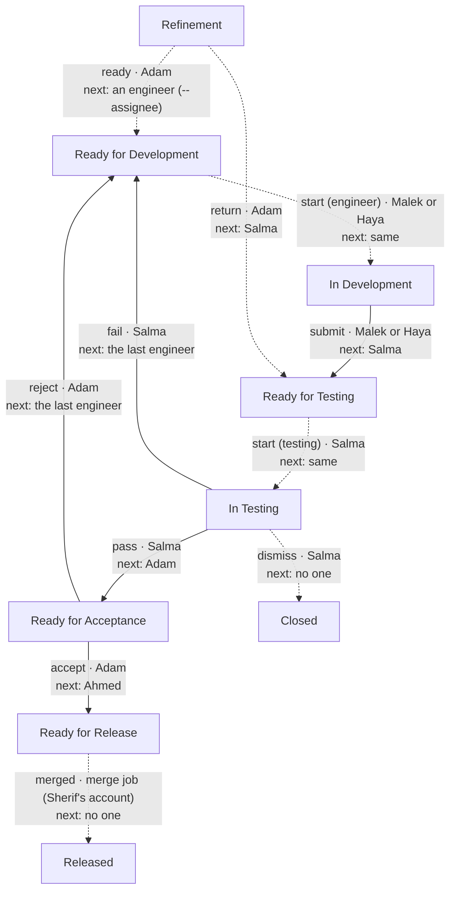

# DFP flow

<!-- Generated by `python -m atl_agent.flowchart --write` from FLOW and OTHER_STEPS. Do not edit by hand: a test fails when this file and the tables differ. -->

How an issue moves in the Dairy Farm Platform project. Solid arrows are the steps of `jira-flow`, the table in `src/atl_agent/client.py`. Dashed arrows are made by other commands. Each arrow says the action, who may make it, and who owns the issue next.

| Action | Command | Who | From | To | Next owner |
|---|---|---|---|---|---|
| submit | `jira-flow` | Malek or Haya | In Development | Ready for Testing | Salma |
| pass | `jira-flow` | Salma | In Testing | Ready for Acceptance | Adam |
| fail | `jira-flow` | Salma | In Testing | Ready for Development | the last engineer |
| accept | `jira-flow` | Adam | Ready for Acceptance | Ready for Release | Ahmed |
| reject | `jira-flow` | Adam | Ready for Acceptance | Ready for Development | the last engineer |
| ready | `jira-ready` | Adam | Refinement | Ready for Development | an engineer (--assignee) |
| return | `jira-return` | Adam | Refinement | Ready for Testing | Salma |
| start (engineer) | `jira-start` | Malek or Haya | Ready for Development | In Development | same |
| start (testing) | `jira-start` | Salma | Ready for Testing | In Testing | same |
| dismiss | `jira-dismiss` | Salma | In Testing | Closed | no one |
| merged | `the merge (close.py)` | merge job (Sherif's account) | Ready for Release | Released | no one |

5 steps are rows of the `jira-flow` table; 6 are made by other commands.
