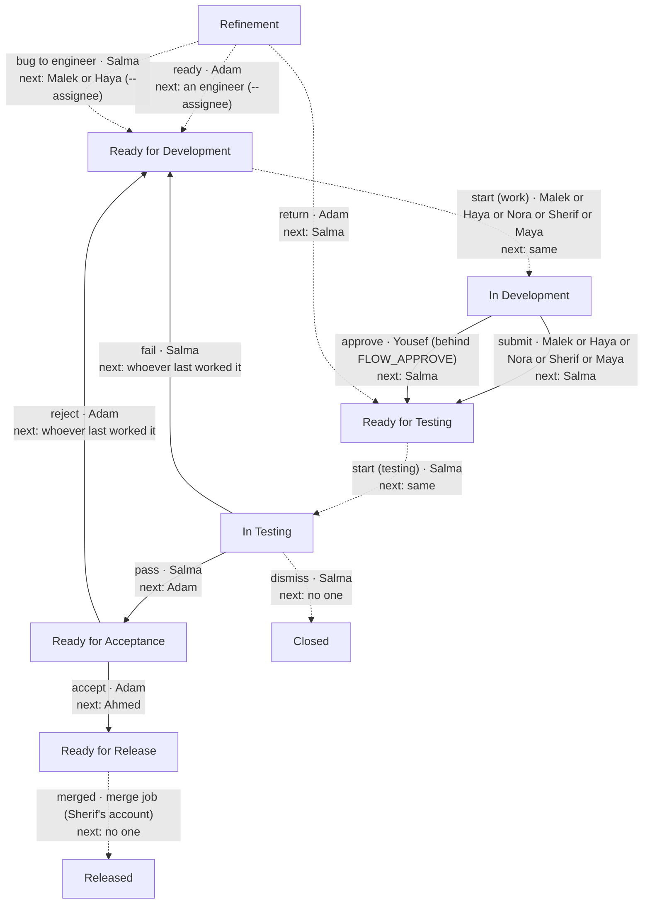

# DFP flow (Dairy Farm Platform only)

<!-- Generated by `python -m atl_agent.flowchart --write` from FLOW and OTHER_STEPS. Do not edit by hand: a test fails when this file and the tables differ. -->

This shows what `atl` allows. Jira does not enforce this flow yet: DFP's workflow lets any status reach any status, so only `atl` keeps to these arrows (read with `python -m atl_agent.flowchart check`, 02/11/2026). Once Jira is narrowed, Jira's own workflow diagram is the one that is enforced.

Solid arrows are the steps of `jira-flow`, the table in `src/atl_agent/client.py`. Dashed arrows are made by other commands. Each arrow says the action, who may make it, and who owns the issue next.

| Action | Command | Who | From | To | Next owner |
|---|---|---|---|---|---|
| submit | `jira-flow` | Malek or Haya or Nora or Sherif or Maya | In Development | Ready for Testing | Salma |
| pass | `jira-flow` | Salma | In Testing | Ready for Acceptance | Adam |
| fail | `jira-flow` | Salma | In Testing | Ready for Development | whoever last worked it |
| accept | `jira-flow` | Adam | Ready for Acceptance | Ready for Release | Ahmed |
| reject | `jira-flow` | Adam | Ready for Acceptance | Ready for Development | whoever last worked it |
| approve | `jira-flow` | Yousef (behind FLOW_APPROVE) | In Development | Ready for Testing | Salma |
| ready | `jira-ready` | Adam | Refinement | Ready for Development | an engineer (--assignee) |
| return | `jira-return` | Adam | Refinement | Ready for Testing | Salma |
| bug to engineer | `jira-create` | Salma | Refinement | Ready for Development | Malek or Haya (--assignee) |
| start (work) | `jira-start` | Malek or Haya or Nora or Sherif or Maya | Ready for Development | In Development | same |
| start (testing) | `jira-start` | Salma | Ready for Testing | In Testing | same |
| dismiss | `jira-dismiss` | Salma | In Testing | Closed | no one |
| merged | `the merge (close.py)` | merge job (Sherif's account) | Ready for Release | Released | no one |

6 steps are rows of the `jira-flow` table; 7 are made by other commands.

Decided, not built (BASITA-41), so not drawn: the status In Acceptance, refuse, blocked, restart, reset.
